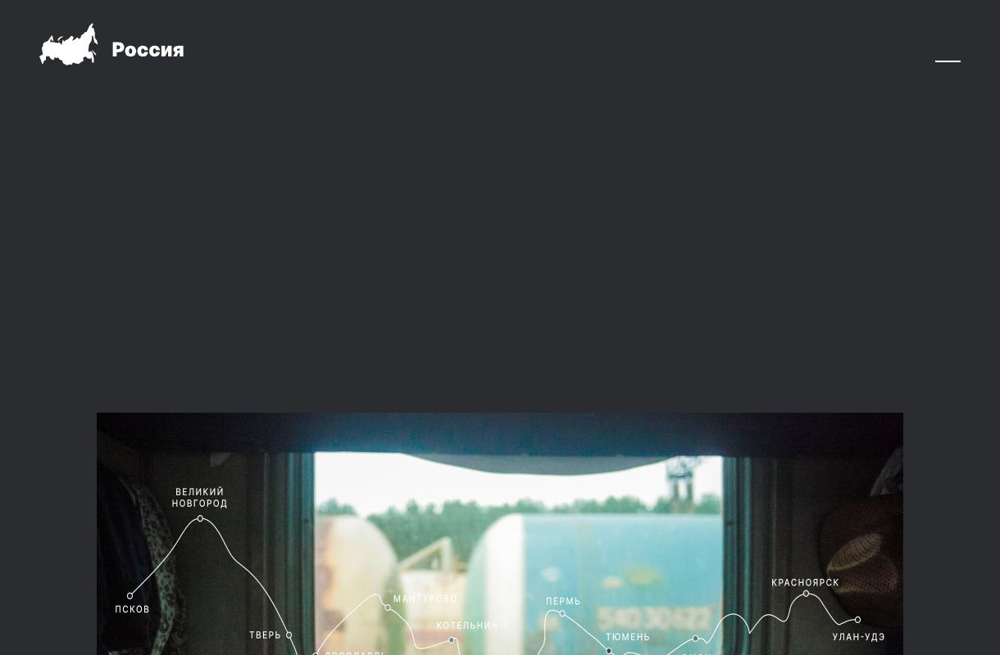

# 🚂 Путешествия по России

**Фотопутеводитель от Куршской косы и Кольского полуострова до Алтая и зимнего Байкала.**

 

[Открыть страницу](https://goldlexx.github.io/russian-travel/)

Развороты о местах объединяют фотографию, авторский текст и ссылку для дальнейшего чтения. Между ними расположены фотосетка, видеоматериалы и отзывы фотографов. На узком экране колонки переходят в последовательную ленту. За композицию отвечают CSS Grid, Flexbox и медиазапросы, стили блоков организованы по БЭМ.

## Локальный запуск

Откройте `index.html` из корня репозитория в браузере.
